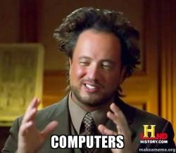
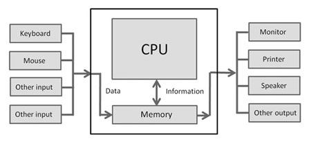
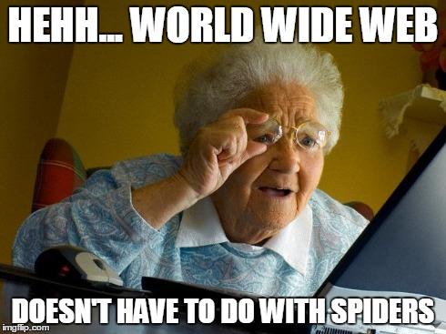
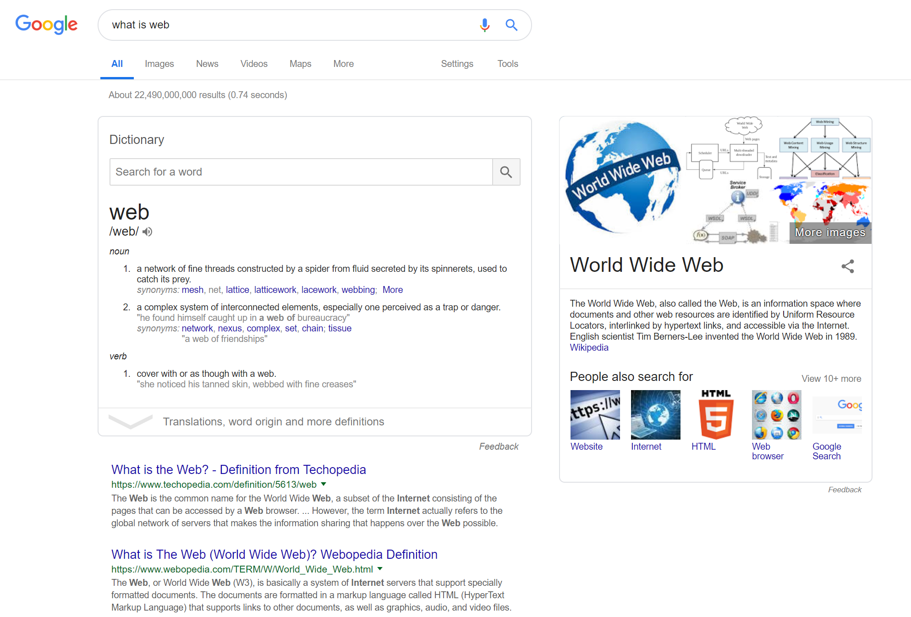
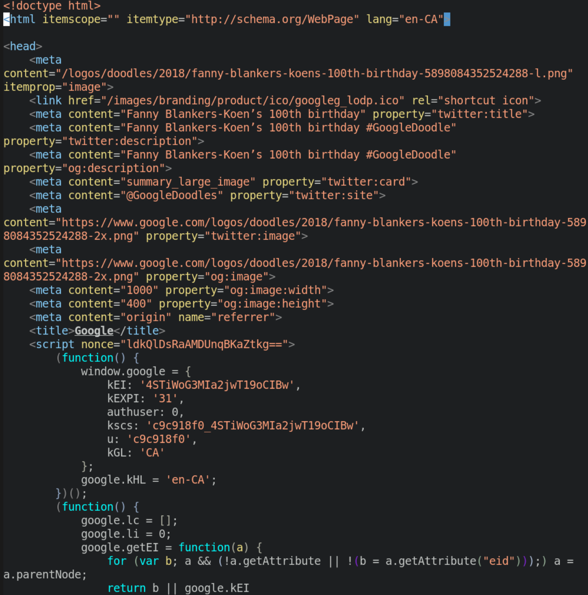
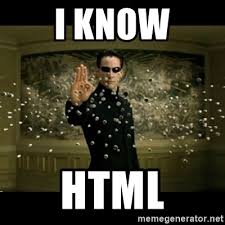

# Let's Learn About Computers




## What is a Computer?

Computers are electronic machines that accept infomation, process the information according to specific instructions, and provide new information as the result. 

*What does that mean??*



Computers can receive information from Mouse, Keyboard, Camera, etc. BUt they don't know how to handle the information intrinsically. You, the *human* must give the computer specific instructions, so they know how to handle the information. 

## Giving Instructions to Computers


We communicate with computers through the same tool with which we communicate with other fellow human beings. We use **language**!!

We simply tell computers what to do for us, and they do it for us!


So... If I want an ice-cream, can I just ask my computer to get one for me? Well, yes... and no!

Imagine if you ask your friend to get an ice-cream for you. Imagine if your friend is nice enough to get the ice-cream for you. They will now there are steps to the goal of getting an ice-cream, and they do the steps without you having to tell them what to do. They know they have to do the following and you do not have to tell them about it:

1. Put your Jacket on.
2. Put your shoes on.
3. Tie your shoelaces.
4. Open the door.
5. Step outside.
6. Close the door.
7. Lock the door.
8. Take the stairs
9. Walk down the ally.
10. Get to the grocery store.
11. Buy an ice-cream.

You get the idea. Your friend must perform lots and lots of step before they get the ice-cream to you. You do not need to inform your friend about these steps, they are smart enough to know.

**Computers are not**. You need to give them instructions for every little bit of thing you want them to do. Sounds frustrating! Yes, but with appropriate instructions, you can get the computers to do anything for you!


We give the instructions to computers thorough **programming languages**. We define each and every step very carefully and computers will go through that steps and do what we want from them. 

In this workshop, we will teach you about the languages which will help you create your own web pages.

But before that, let's see what is internet, what is this thing called the **world wide web**.


## What is the World Wide Web?



From Wikipedia:

"The World Wide Web (WWW), also called the Web, is an information space where documents and other web resources are identified by Uniform Resource Locators (URLs), interlinked by hypertext links, and accessible via the Internet."

**WHAT??**

In simpler words, World Wide Web is a virtual space where all the computers in the world can communicate with each other and share information with each other.

For example, when you want to Google something, computers do the following:

1. Your computer connects to a computer *running* Google's website somewhere in the world.
2. The Google computer stands-by for the information from your computer
3. Your computer send the *keyword* you want to search to the Google's computer
4. Google's computer processes your request
5. Google's computer shares the result of the search with your computer
6. Your computer receives the information from Google's computer, processes it, and show the result to you.



This is just a start, but we now know a little bit about Internet. It is time to create our own web-pages now!

## Webpages and Computing Languages

When you go to Google's website, you see this:


<br>

But, what computers really see is this:

<br><br>




**What does this all mean??** We will teach you to understand! This is not as complicated as it looks, we promise!

This is code, written in HTML. We need to understand what HTML is, and how it works.

## Introduction to HTML



---
#### Activity 1-1
Sometimes it is better to try first and learn afterwards. Follow these steps and by the end of today you will learn the rational behind each.

1. Open your code playground. A code playground is a live environment which continuously interprets your code.

2. On the HTML tab, put the following. 

```
<!DOCTYPE html>
<html>
<head>
<title>Title Goes Here</title>
</head>
<body>

<h1>My name is...</h1>
<p>I think computers are...</p>

</body>
</html>
```
3. Continue making amendments where you see "...". Try to observe and understand what happens to the outcome when you make certain changes to the code.
---

You just made your first HTML web-page!


Everything in HTML goes inside a tag. Tags are specific instructions given by the user to the interpretation machine. All tags start with a < (left bracket) and a > (right bracket). Stuff like `<!DOCTYPE>`, `<html>`, and `</html>` are some of the tags in the code snippet above.<br>

<br>
<br>

---

#### Activity 1-2
Try to find the rest of the **tags** with the help of your teammates.

---

Now that we can identify the tags,let's revisit the code above and try to understand what we did there and learn along the way:

* The `<!DOCTYPE html>` declares that this document is a html document.
* `<html>` and `</html>`mark the beginning and the end of the **HTML element**. <br>

<br>
<br>

---

#### Elements
`<html>` is called a **start** tag, and `</html>` is called an **end** tag.<br>
A html document consists of **elements**. The body that goes between a start tag and an end tag is called an **element** in html.<br>
For example, the **HTML element** in the code above consists of everything from the start tag `<html>` to the end tag `</html>`

---
<br>
<br>

---

#### Activity 1-3
Try to find the rest of the **elements** with the help of your teammates.
You can review some of the most important html tags <a href="htmlcheatsheet.pdf"> here </a>

---

* **Start tag** `<head>` starts the *head element* and `<!head>` finishes it.
* The author can write the title of the webpage between `<title>` and `</title>` tags.
* The body of the webpage (the *body element*) goes between `<body>` and `</body>`.
* `<h1>` and `</h1>` indicate what goes between is stylistically a header. 

